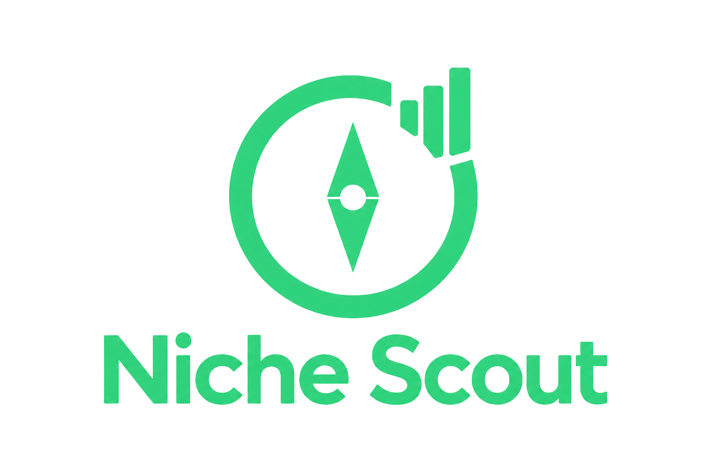
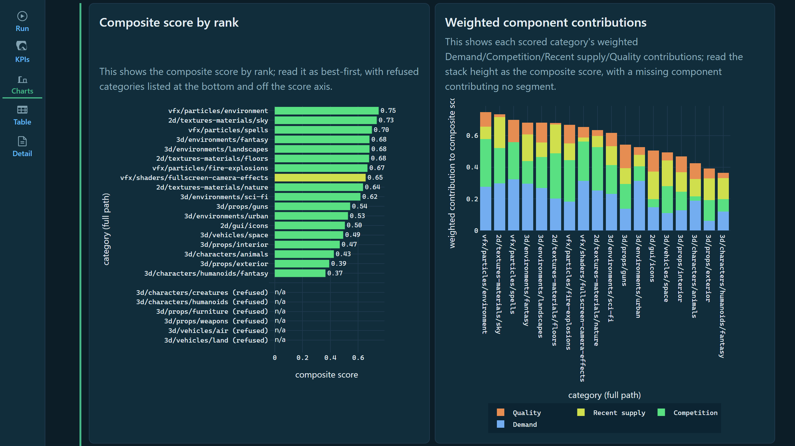
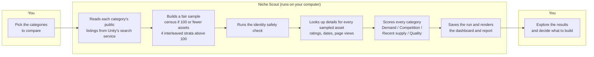

# Unity Asset Store Niche Scout

**A local research tool for Unity Asset Store publishers: compare a set of asset categories side by side before you decide what to build.**

> **Independent project; use at your own risk.** Niche Scout is not affiliated with or endorsed by Unity Technologies. It sends automated requests to Unity Asset Store endpoints using credentials from your own session. Unity's Terms of Service restrict automated access to the Asset Store and its APIs without a separate agreement, and breaches may lead to account suspension or other action. The author provides this software as is, without warranty, and does not authorize or encourage any use that violates Unity's terms. You are solely responsible for reading those terms and deciding whether and how to use this tool.

Unity Asset Store Niche Scout (Niche Scout for short) reads the same public category listings your browser sees on the Unity Asset Store, studies a fair sample of the assets inside each category you choose, and produces a ranked comparison built from four signals:

| Signal | What it means in plain language |
|---|---|
| **Demand** | How many page views the sampled assets get. Read it as a trailing-7-day view count. |
| **Competition** | How crowded the category is by verified catalog size. Higher = less crowded, which is good for a new entrant. |
| **Recent supply** | How settled the category looks versus being flooded with brand-new releases. Read it as balance, not sales velocity. |
| **Quality** | How highly rated the sampled assets are. Read it as observed rating strength, not sales. |

Niche Scout shows the result as a **composite score** in an interactive dashboard or a shareable HTML/text report.

> **What Niche Scout is not.** The score is a deterministic, sample-based, *within-run* heuristic. It is **not** a sales, revenue, download, or demand predictor, and it is **not** a statistically representative estimate of the marketplace. It has not been calibrated against sales, revenue, downloads, or conversion. Use it to shortlist categories that deserve a closer look — never as a business plan or revenue forecast.

Niche Scout is a personal, local tool. It is not affiliated with or endorsed by Unity Technologies.

---

## Contents

1. [What you need before you start](#what-you-need-before-you-start)
2. [Quick start (the short version)](#quick-start-the-short-version)
3. [Step 1 — Install](#step-1--install)
4. [Step 2 — Add your two access keys](#step-2--add-your-two-access-keys)
5. [Step 3 — Pick the categories you want to compare](#step-3--pick-the-categories-you-want-to-compare)
6. [Step 4 — Run the scan](#step-4--run-the-scan)
7. [Step 5 — Explore your results](#step-5--explore-your-results)
8. [How to read the results](#how-to-read-the-results)
9. [Troubleshooting](#troubleshooting)
10. [Frequently asked questions](#frequently-asked-questions)
11. [How it works under the hood](#how-it-works-under-the-hood)
12. [For developers](#for-developers)

---

## What you need before you start

- **A computer** running Windows, macOS, or Linux.
- **Python 3.11 or newer** installed. Check by running `python --version` (Windows) or `python3 --version` (macOS/Linux). If it prints 3.11 or higher, you are set.
- **A Unity account** (a free account is fine) and a browser where you are logged in to <https://assetstore.unity.com>.
- **Two access keys copied from your own browser session** (explained in Step 2). Niche Scout does not log in for you and does not ask for your Unity password.
- **Time and disk space.** Niche Scout deliberately paces itself to be gentle on Unity's servers, so a scan is slow: expect tens of minutes to a couple of hours for a full run. Niche Scout can also write several hundred MB of data to your hard drive on a large run.

Niche Scout never sends your credentials anywhere except to Unity's own web services, and it never stores them in its database, logs, or reports.

---

## Quick start (the short version)

If you are comfortable in a terminal, this is the whole workflow:

```powershell
# 1. Install (from the project folder)
python -m venv .venv
.\.venv\Scripts\Activate.ps1
pip install -e .

# 2. Set your two keys in this terminal
$env:NICHESCOUT_COVEO_BEARER_TOKEN = "paste-coveo-token"
$env:NICHESCOUT_UNITY_CSRF_TOKEN = "paste-csrf-token"

# 3. Edit config/categories.json (pick 8+ categories)

# 4. Run the scan and write an HTML report
niche-scout run --report runtime/report.html

# 5. Open the dashboard
niche-scout dashboard
```

The commands above are for Windows PowerShell; macOS/Linux equivalents are in Step 1. Each step is explained in detail below.

---

## Step 1 — Install

### Windows (PowerShell)

1. Download this project (or `git clone` it) to a folder you can find, for example `Documents\Unity Asset Store Niche Scout`.
2. Open **PowerShell** and go to that folder. Replace the path with your own if needed:

   ```powershell
   cd "$HOME\Documents\Unity Asset Store Niche Scout"
   ```

3. Create a private Python environment for Niche Scout and install it:

   ```powershell
   python -m venv .venv
   .\.venv\Scripts\Activate.ps1
   pip install -e .
   ```

   If PowerShell refuses to run the activation script, allow it just for this window and try again:

   ```powershell
   Set-ExecutionPolicy -Scope Process -ExecutionPolicy Bypass
   .\.venv\Scripts\Activate.ps1
   ```

4. Confirm Niche Scout is installed:

   ```powershell
   niche-scout --help
   ```

   You should see the `run` and `dashboard` commands.

### macOS / Linux

```bash
cd "$HOME/Documents/Unity Asset Store Niche Scout"
python3 -m venv .venv
source .venv/bin/activate
pip install -e .
niche-scout --help
```

### A note about terminal windows

Your keys (Step 2) and your active Python environment live **inside one terminal window**. If you close it, open a new one and repeat the activation step (`.\.venv\Scripts\Activate.ps1` on Windows, `source .venv/bin/activate` on macOS/Linux). Running the commands from the project folder also matters, because Niche Scout finds the config files relative to the folder you run from.

---

## Step 2 — Add your two access keys

Niche Scout needs two values that your browser already uses when it talks to the Unity Asset Store. You copy them from your browser once, then give them to Niche Scout through environment variables.

- `NICHESCOUT_COVEO_BEARER_TOKEN` — the token the Asset Store's search service uses.
- `NICHESCOUT_UNITY_CSRF_TOKEN` — the session token the Asset Store's product-detail service uses.

Niche Scout never asks for your Unity username or password. These tokens come from *your own logged-in browser session*, and they expire after a while — when they do, you repeat these steps to refresh them.

### Finding the Coveo token

1. Open <https://assetstore.unity.com> in your browser and make sure you are logged in.
2. Press **F12** to open the browser's developer tools, and switch to the **Network** tab.
3. In the store, browse or search so that listing data loads (for example, open any category page).
4. In the Network list, find a request whose address contains `coveo.com` and `rest/search/v2`.
5. Open that request and look at its **Headers**. Find the `Authorization` header — its value looks like `Bearer eyJ...`.
6. Copy everything **after** the word `Bearer ` (the long `eyJ...` part). That is your Coveo token.

### Finding the CSRF token

1. Still in developer tools, open any **product page** on the Asset Store so a request to `assetstore.unity.com/api/graphql/batch` appears (you can also use the Network tab's filter box and type `graphql`).
2. Open that request and find either:
   - the `x-csrf-token` request header, or
   - the `_csrf` cookie (you can also find it under **Application → Cookies → https://assetstore.unity.com**).
3. Copy that value (a short string of letters and numbers). That is your CSRF token.

### Giving the keys to Niche Scout

Set both keys in the **same terminal window** from which you will run Niche Scout.

**Windows PowerShell (this window only):**

```powershell
$env:NICHESCOUT_COVEO_BEARER_TOKEN = "paste-the-coveo-token-here"
$env:NICHESCOUT_UNITY_CSRF_TOKEN = "paste-the-csrf-token-here"
```

**Windows PowerShell (save for future windows):**

```powershell
setx NICHESCOUT_COVEO_BEARER_TOKEN "paste-the-coveo-token-here"
setx NICHESCOUT_UNITY_CSRF_TOKEN "paste-the-csrf-token-here"
```

`setx` only affects **new** terminal windows, so close and reopen PowerShell afterward.

**macOS / Linux (this window only):**

```bash
export NICHESCOUT_COVEO_BEARER_TOKEN="paste-the-coveo-token-here"
export NICHESCOUT_UNITY_CSRF_TOKEN="paste-the-csrf-token-here"
```

To keep them across sessions, add those two `export` lines to your `~/.zshrc` or `~/.bashrc`.

**Safety rules for keys**

- Never paste these tokens into a file that gets committed to Git, into an issue, or into a chat. The project's `.gitignore` already excludes `.env` files and the `runtime/` folder.
- Niche Scout never writes the key values into its database, logs, or reports. Request logs record names, statuses, and hashes only.
- Treat these tokens like a temporary password. If one is ever exposed, log out of the Asset Store (or wait for it to expire) and capture a fresh one.

---

## Step 3 — Pick the categories you want to compare

You choose the categories in one small file: `config/categories.json`. Open it in any text editor. Its important part is the `categories` list:

```json
{
  "categories": [
    "3d/characters/humanoids",
    "3d/environments/fantasy",
    "3d/props/weapons",
    "2d/gui/icons"
  ]
}
```

The included demo file already lists 24 categories; replace them with the ones you care about.

**Rules and guidance**

- **Use the exact path names from the store.** The valid list ships in `config/category_taxonomy.json` — open it and copy paths from `canonical_category_paths`. Paths are lowercase, separated by `/`, and must match exactly (for example `3d/characters/humanoids`, not `3D/Characters/Humanoids`).
- **Pick at least 8 categories.** Niche Scout rejects a run with fewer than 8 categories before any ranking happens.
- **8 to 20 categories = a provisional run.** Niche Scout completes the run and shows scores, but deliberately refuses to call anything `rankable`, because there are too few categories to compare against each other. The stability tiles read `n/a`.
- **21 or more categories = a full comparison.** Niche Scout can then grade categories `rankable`. This is the setting to use when you want a shortlist.
- **Niche Scout compares each category against the others in the same run.** Pick categories you would genuinely choose between, and prefer a set at a similar level (for example, several character categories) over an apples-to-oranges mix. The ranking means "best relative position within *this* set", not a universal truth.
- **More categories means a longer scan.** 21–30 categories is a practical sweet spot.

You can start from the taxonomy and build a smaller set, or use the demo set of 24 as-is.

---

## Step 4 — Run the scan

From the project folder, with your keys set and your Python environment active:

```powershell
niche-scout run --report runtime/report.html
```

When you run it, Niche Scout does the whole job:

1. **Checks your setup** — verifies there are at least 8 categories, that the cached category list is current, and that both keys are present.
2. **Discovers assets** — reads each chosen category's public listing pages from the Asset Store search service, one page at a time, saving every raw observation to a local database.
3. **Builds a fair sample** — for categories with 100 or fewer assets it studies every asset ("census"); for larger categories it splits them into four interleaved groups and picks up to 100 assets deterministically, so early, middle, and late positions in the listing are all represented.
4. **Runs a safety check** — looks up a small set of assets to confirm the identity mapping works before any bulk lookup begins.
5. **Looks up details** — fetches rating, review count, publication date, and page views for each sampled asset, once per unique asset.
6. **Scores every category** — computes Demand, Competition, Recent supply, and Quality, then blends them into the composite score.
7. **Saves and reports** — writes everything to the local database and, if you passed `--report`, writes the report file and prints its path.

### What you will see while it runs

Niche Scout prints messages to the terminal in the form `LEVEL logger: message`. Log lines appear as the run progresses, and there is no live progress bar. Near the end, look for a line like:

```text
INFO niche_scout.pipeline: pre-enrichment projection: discovered_canonical_assets=... sampled_assets=... unique_enrichment_identities=... projected_minimum_enrichment_seconds=...
```

Niche Scout's projected time is an honest **lower bound** on how long the remaining lookups will take. The final line tells you the outcome:

```text
INFO niche_scout.pipeline: run run-2026-10-04T12:00:00+00:00: completed
```

or `failed` if the safety check stopped the run before bulk lookups (see [Troubleshooting](#troubleshooting)). The run ID is the middle part of the line (`run-2026-10-04T12:00:00+00:00` in the example above).

### How long it takes

Niche Scout intentionally paces itself: roughly one listing request per second, and roughly two detail requests per second, plus normal network latency. A run over a handful of small categories finishes in minutes; a 21+ category run over large catalogs can legitimately take a long time (tens of minutes to a couple of hours). Let it finish, and do not close the window. There is no pause/resume feature — an interrupted run must be started over.

### Exit codes

| Code | Meaning |
|---|---|
| `0` | The run completed (including a provisional 8–20 category run). |
| `1` | A runtime failure — including a run stopped because the safety check failed. Niche Scout printed limitation messages to the terminal. |
| `2` | A usage or setup problem — for example missing keys, fewer than 8 categories, or a stale category list. |

### Useful variations

```powershell
# Plain-text report instead of HTML
niche-scout run --report runtime/report.txt --report-format text

# Use a different category file
niche-scout run --categories my-categories.json

# Raise the per-category listing cap (default 9000)
niche-scout run --max-discovery-results-per-category 15000
```

---

## Step 5 — Explore your results

### The dashboard (recommended)

Once at least one run has completed, start the dashboard:

```powershell
niche-scout dashboard
```

The command prints a local address, for example:

```text
niche-scout dashboard: http://127.0.0.1:8050/
```

Open that address in your browser. The dashboard is served only to your own computer (the command does not open a browser for you, and nobody else can see it). Press **Ctrl+C** in the terminal when you are done — that stops the dashboard.

The dashboard gives you a ranked score bar, a breakdown of each category's four signals, a comparison of ranks under the three diagnostic scoring policies, the discovered catalog sizes, and a detail panel for every category. Every value shown comes straight from the saved run — Niche Scout does not recompute anything while you browse.



The screenshot shows two of the dashboard charts: **Composite score by rank** (refused categories are listed at the bottom as `n/a`) and **Weighted component contributions**, which stacks each category's Demand, Competition, Recent supply, and Quality shares.

**To view an older run**, find its run ID (Niche Scout prints it in the terminal at the end of a run and includes it in the report) and run:

```powershell
niche-scout dashboard --run-id run-2026-10-04T12:00:00+00:00
```

If you omit `--run-id`, Niche Scout shows the most recent run.

### The report file

If you run with `--report runtime/report.html`, you get a self-contained HTML file you can open in any browser, save, or share. Passing `--report-format text` writes a plain-text version instead. The report contains the same information as the dashboard, including the fixed statement about how to interpret the score and its limitations.

---

## How to read the results

### The score

Niche Scout blends the four signals into a **composite score** between 0 and 1. Higher is better *relative to the other categories in the same run*. Read it as a ranking aid inside one comparison, not as a grade of the category in absolute terms.

### The four signals

Niche Scout builds each signal from the sampled data:

- **Demand (D)** — from the page-view index (a trailing-7-day view count). Higher = more attention on the sampled assets.
- **Competition (C)** — from how many assets the category contains. Higher = less crowded, which is more favorable for entering.
- **Recent supply (R)** — from how much of the catalog is recent (published in the last 365 days) and how old a typical asset is. Higher = less pressure from a wave of recently released competitors.
- **Quality (Q)** — from ratings (assets need at least 5 ratings to count). Higher = stronger observed rating strength.

Niche Scout shows a signal as "n/a" when there is not enough usable data. **`n/a` means "Niche Scout could not measure this" — it never means zero.** Niche Scout deliberately keeps a measured zero and a missing value separate everywhere.

### Evidence and rankability

- **Evidence strength** is an ordinal label (`insufficient`, `weak`, `moderate`, `strong`). It describes how much usable data supports the category's score. It is not statistical confidence.
- **Rankable?** tells you whether the category has enough evidence to receive a final rank. A category can be `not_rankable` (not enough trustworthy data), `provisional` (score is computable, but the run or the evidence is not strong enough for a final rank), or `rankable`. Niche Scout keeps non-rankable categories visible — it never hides them.

Remember: **Niche Scout can never label results `rankable` when the run has 8–20 categories.** If you want a ranked shortlist, use 21 or more categories.

### Warnings you may see

The report attaches short warning codes to categories when something limits confidence. The most common ones:

| Warning | Plain meaning |
|---|---|
| `SAMPLE_BASED_SIGNAL` | Niche Scout scored this category from a sample, not the whole catalog. |
| `DISCOVERY_TRUNCATED` | The category has more assets than the listing cap, so Niche Scout read only part of it. |
| `DISCOVERY_INCOMPLETE` | Niche Scout could not reconcile the listing counts, so it may be missing some assets. |
| `DISCOVERY_PAGE_FAILED` | One or more listing pages failed, so Niche Scout holds only partial data for the category. |
| `IDENTITY_UNRESOLVED` / `IDENTITY_CONFLICT` | Niche Scout could not reliably match some assets to a storefront product, so it excluded them. |
| `INSUFFICIENT_DEMAND_SAMPLE` / `INSUFFICIENT_RECENT_SAMPLE` / `INSUFFICIENT_QUALITY_SAMPLE` | Niche Scout found too little usable data for that signal, so it treats the signal as unavailable. |
| `REFERENCE_SET_SMALL` | The run has fewer categories than Niche Scout needs for a stable comparison. |
| `RANKING_SENSITIVITY_HIGH` | Ranks move noticeably when the scoring emphasis changes; treat the ordering as less stable. |
| `PAGE_VIEW_SEMANTICS_CONTRADICTED` | The page-view data did not match its expected weekly meaning for this category. |
| `STATE_EXCLUDED` | Niche Scout excluded an asset that is not currently published. |
| `IDENTITY_PREFLIGHT_FAILED` | The safety check failed; Niche Scout stopped bulk lookups and marked the run failed. |

### The stability tiles

The dashboard shows top-3 and top-5 stability and the maximum rank shift. These describe how much the ordering changes when Niche Scout re-ranks the same data with different fixed emphasis (a diagnostic, not a different recommendation). `n/a` means there were too few rankable categories to compute it.

---

## Troubleshooting

### Setup and keys

| What you see | Likely cause | What to do |
|---|---|---|
| `error: Missing required credentials: NICHESCOUT_COVEO_BEARER_TOKEN and NICHESCOUT_UNITY_CSRF_TOKEN must both be set before network collection` | The keys are not set in **this** terminal window. | Set both keys in the same window (Step 2) and check with `echo $env:NICHESCOUT_COVEO_BEARER_TOKEN` (PowerShell) or `echo $NICHESCOUT_COVEO_BEARER_TOKEN` (macOS/Linux). If it prints nothing, the variable is not set. |
| `error: a run with fewer than 8 requested categories is rejected before ranking` | Your category list is too short. | Add categories to `config/categories.json` so there are at least 8; for a rankable result, use 21 or more. |
| `error: duplicate category '...'` | The same path appears twice in your list. | Remove the duplicate. |
| `error: the taxonomy did not validate (status 'missing_categories')` | A category path is not spelled exactly like the store's path. | Copy the path again from `config/category_taxonomy.json` (lowercase, exact spelling). |
| `error: the taxonomy did not validate (status 'stale')` | The bundled category list was captured more than 30 days ago. | Either relax the freshness check consciously — `niche-scout run --max-taxonomy-age-days 365` — or ask a maintainer to refresh `config/category_taxonomy.json`. Only the check changes; the category list itself does not. |
| `error: the taxonomy file cannot be read` / `is not valid JSON` | The taxonomy file is missing or was edited incorrectly. | Restore `config/category_taxonomy.json` from the repository. |

### During a run

| What you see | Likely cause | What to do |
|---|---|---|
| The run pauses and seems frozen | Niche Scout paces its requests (about one request per second) and silently retries temporary service errors with increasing waits. | Wait. Log lines appear only at stage boundaries, not for every request, so quiet stretches are normal. Do not open a second run. |
| A category ends with a failure or `request_failed` note | A listing page kept failing after automatic retries (a temporary service error or a rate limit). | The run continues with the other categories and marks the affected one in the report. Re-run later if you need that category complete. |
| The run ends `failed` with `IDENTITY_PREFLIGHT_FAILED` | The safety check could not confirm the product lookups are working. The most common reason is an expired or mistyped CSRF token. | Capture fresh tokens (Step 2), set them, and run again. Nothing was bulk-collected, so a retry is cheap. |
| The process was closed early | There is no resume feature. | Start the run again from the beginning. |
| `error: database ... is locked` | Something else has the database open. | Close any running dashboard (Ctrl+C) and any other tool using `runtime/niche_scout.sqlite3`, then retry. |
| Disk space warnings | Niche Scout writes a lot of data on large runs — hundreds of MB is normal. | Free up space or run fewer/smaller categories. |

### Dashboard and reports

| What you see | Likely cause | What to do |
|---|---|---|
| `error: no runs recorded in the database` | You started the dashboard before any run finished. | Run `niche-scout run` first, then start the dashboard again. |
| `error: run_id not found: ...` | The run ID does not exist in your database (typo, or a different database file). | Omit `--run-id` to open the most recent run, or copy the exact ID from a previous run's final log line. |
| `error: dashboard server stopped: ... address already in use` | Something else already uses port 8050. | Close the other program (often another dashboard) and start it again. There is no port flag; Niche Scout always uses `127.0.0.1:8050`. |
| The `--report` file was not created | Niche Scout writes the report only after a **successful** run. | Read the terminal output: Niche Scout prints the limitations there when a run fails. Fix the cause, then run again. |
| A result shows `n/a` | The value could not be measured (not zero). | Nothing to fix — check that category's warnings to see why data was unavailable. Many `n/a` values usually mean small catalogs or missing ratings/dates. |
| Everything is `provisional` or unranked | The run had 8–20 categories. | Add categories so the run has 21 or more, and run again. |
| You want a different weighting | Weights are fixed on purpose in this version. | Not configurable; the ranking-sensitivity chart shows how much the ordering would move under other fixed emphases. |

---

## Frequently asked questions

**Do I need a paid Unity account?**
No. A normal logged-in browser session on the Asset Store is enough to capture the two tokens.

**Is this safe to use? Will it get my account in trouble?**
Niche Scout only reads the same public listing and product data your browser already loads, using your own session, at a deliberately slow pace. It does not log in for you, and it never uploads or changes anything. That said, it is an unofficial personal research tool — use your own judgment and keep runs reasonable and infrequent.

**Where is my data stored?**
Everything stays on your computer in `runtime/niche_scout.sqlite3` (Niche Scout creates it on the first run). The dashboard and reports read that file, and Niche Scout uploads nothing. To start completely fresh, run no scans or dashboards, delete that file, and run again.

**Are my keys stored anywhere?**
Only in your terminal's environment variables, as long as that window is open (or in your shell profile if you chose to persist them). Niche Scout never writes them into the database, logs, or reports.

**Can I compare two runs against each other?**
No. Scores are explicitly **within-run**: they describe relative positions among the categories you selected that time. Two runs with different category sets are not comparable, and Niche Scout makes no claim that they are.

**Can I run two scans at the same time?**
No. Niche Scout runs one scan at a time, and all runs share one database file. Finish (or cancel) one before starting another.

**Can I stop and resume a run?**
Not in this version. If you interrupt a run, you must start it over from the beginning.

**Why did my run produce no `rankable` categories even though it "succeeded"?**
Exit code `0` means the pipeline completed, not that everything ranked. With 8–20 categories the run is provisional by policy; with 21+ categories, individual categories may still be `not_rankable` when their evidence is weak (see the warnings column).

**How current is the bundled category list?**
The category list in `config/category_taxonomy.json` is a dated snapshot. Niche Scout refuses to use it after 30 days by default, so that stale category paths cannot silently break a run. Refresh the tokens freely; refresh the category list only with a maintainer's help or by relaxing the check with `--max-taxonomy-age-days`.

---

## How it works under the hood

The diagram below shows who does what: everything in a **You** box is a step you take, and everything in the **Niche Scout** box happens automatically on your computer.



Design guarantees worth knowing:

- **Deterministic.** Niche Scout never uses randomness. Given the same data and settings, it produces the same sample and the same scores.
- **Missing is not zero.** When Niche Scout cannot measure something, it records the value as unavailable and shows `n/a`; it never silently treats it as 0.
- **Pure scoring core.** Niche Scout's scoring code has no network, disk, or clock access; it receives an explicit cutoff time and plain typed values.
- **Fixed policy.** Niche Scout's weights, thresholds, and sampling rules are frozen for this version, so the primary score and its sensitivity diagnostics cannot drift apart.
- **Auditable.** Niche Scout records every run's configuration snapshot, sampling geometry, request metadata (without secrets), and per-category evidence, so you can trace a category's score back to the sampled assets.

### Full architecture map

This is the generated map of the actual code modules, including the network boundary that keeps your credentials out of the analytical core and the pure modules that do the scoring:

<picture>
  <source media="(prefers-color-scheme: dark)" srcset="images/architecture-dark.svg">
  
</picture>

The [interactive version](.archify/architecture-niche-scout-20261003-091932/niche-scout.html) adds panning, zooming, focus, themes, and image export; download the file and open it in a browser. The [technical analysis report](Documents/reports/niche-scout-technical-analysis-2026-10-03.md) examines the design, its guarantees, and its limits in depth.

---

## For developers

```powershell
# Install with test dependencies
pip install -e ".[test]"

# Run the full test suite (offline; no live network calls)
python -m pytest -q

# Verify requirement traceability and quality gates
python -m niche_scout.tools.validate_traceability
python -m niche_scout.tools.check_import_boundaries
python -m niche_scout.tools.check_scope_prohibitions
python -m niche_scout.tools.check_secrets
```

Project layout:

```text
config/                 categories, taxonomy, default settings
src/niche_scout/        the package
  models.py             typed records and frozen constants
  config.py             configuration and credential boundaries
  validation.py         taxonomy, identity, and response-shape checks
  sampling.py           deterministic sample selection
  metrics.py            raw metric estimators (pure)
  scoring.py            normalization, components, evidence, sensitivity (pure)
  collector_coveo.py    category listing collection
  collector_graphql.py  product detail collection
  database.py           local SQLite persistence
  pipeline.py           run orchestration
  report.py             HTML/text reports and the dashboard
  cli.py                command-line interface
  tools/                quality and traceability checks
tests/                  offline tests and fixtures
Documents/              requirements, plans, reports
runtime/                local database and reports (git-ignored)
```

The normative requirements live in `Documents/SRS-lean-v2.md`. Analytical tests carry `@pytest.mark.lreq` markers backed by `tests/traceability.json`.

---

## Terms notice

The first time you run `niche-scout run`, it prints the notice at the top of this README and asks you to type `I understand` before it sends any request; your acknowledgement is remembered locally and later runs continue without prompting. `--accept-terms` confirms the notice for a single non-interactive run without prompting and does not remember anything. `niche-scout dashboard` reads your local database only and sends no requests, so it never asks for this acknowledgement.

## License

Niche Scout is released under the MIT License. See [LICENSE](LICENSE) for the full text.
